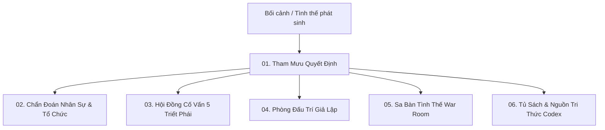

# HƯỚNG DẪN SỬ DỤNG ỨNG DỤNG NHÂN THUẬT (EXECUTIVE STUDIO)
*Cẩm nang vận hành dành cho Nhà Điều Hành, Lãnh Đạo & Chuyên Viên Chiến Lược*

---

## 1. GIỚI THIỆU TỔNG QUAN

**Nhân Thuật (Executive Studio / BusinessOS)** là hệ thống phần mềm tham mưu mưu lược, chẩn đoán hành vi con người và mô phỏng quyết định điều hành. Ứng dụng tích hợp tinh hoa giữa **Tâm lý học hành vi hiện đại**, **Lý thuyết trò chơi (Game Theory)** và **5 Lăng kính Triết học mưu lược phương Đông & phương Tây kinh điển** (Thuật Hùng Biện, Nho Gia, Pháp Gia, Đạo Gia, Tuân Tử).

### Giá trị cốt lõi của ứng dụng
- **Nhìn người (Tri nhân):** Bóc tách động cơ thật, nỗi sợ thầm kín và điểm mù nhận thức của từng cá nhân trong tổ chức.
- **Rõ thế (Minh thế):** Nhìn thấy mạng lưới quan hệ ngầm, liên minh phe phái và dòng chảy quyền lực phía sau các biến cố.
- **Quyết định (Thành sự):** Chuyển hóa phân tích thành kịch bản hành động cụ thể (Action Script) có thể kiểm chứng, thử nghiệm trước trong môi trường đối kháng giả lập trước khi trả giá ngoài đời thật.

---

## 2. YÊU CẦU HỆ THỐNG & KHỞI CHẠY ỨNG DỤNG

### 2.1. Yêu cầu môi trường
- **Hệ điều hành:** Windows 10/11, macOS, hoặc Linux.
- **Python:** Phiên bản 3.11 trở lên.
- **Trình duyệt khuyến nghị:** Google Chrome, Microsoft Edge, Brave, Safari, Firefox (hỗ trợ hiển thị giao diện Dark Glassmorphism tối ưu).
- **Mạng:** Hệ thống có khả năng chạy **100% Offline (Deterministic Mode)**. Khi cấu hình thêm API Key AI, hệ thống sẽ mở rộng tính năng tổng hợp luận điểm sâu (Deep LLM Synthesis).

---

### 2.2. Khởi chạy ứng dụng

#### Cách 1: Khởi chạy trực tiếp bằng Python (Khuyến nghị cho phát triển & nội bộ)
Mở PowerShell (Windows) hoặc Terminal (macOS/Linux) tại thư mục gốc của dự án:

```powershell
# 1. Kích hoạt môi trường ảo Python
.venv\Scripts\Activate.ps1    # Trên Windows
# hoặc: source .venv/bin/activate  (Trên Linux/macOS)

# 2. Cài đặt các gói phụ thuộc (nếu là lần đầu tiên)
pip install -r requirements.txt

# 3. Khởi chạy máy chủ ứng dụng
python -m backend.app.main
```

Máy chủ sẽ thông báo:
```text
Starting BusinessOS & NhanThuat Web Dashboard Server on http://0.0.0.0:8000...
```

#### Cách 2: Khởi chạy bằng Docker
Nếu máy của anh đã cài Docker:
```bash
docker compose up -d --build
```

---

### 2.3. Cấu hình Trí Tuệ Nhân Tạo (Tùy chọn)
Mặc định hệ thống hoạt động theo nguyên tắc **Fallback-First** (truy xuất tri thức có sẵn cực nhanh mà không cần API key). Để kích hoạt tính năng viết luận giải đa tầng và tổng hợp mưu lược nâng cao:
1. Mở file `.env` tại thư mục gốc.
2. Thêm hoặc cập nhật key Google Gemini (có thể lấy miễn phí tại [Google AI Studio](https://aistudio.google.com/apikey)):
   ```env
   GOOGLE_API_KEY=AIzaSy...
   ```

---

## 3. TRUY CẬP & ĐĂNG NHẬP HỆ THỐNG

### 3.1. Địa chỉ truy cập
- **Trang giới thiệu triết lý (Landing Page):** `http://localhost:8000/`
- **Không gian làm việc điều hành (Web App Studio):** `http://localhost:8000/app` (hoặc bấm nút **"Mở Ứng Dụng"** / **"Truy Cập Hệ Thống Lõi"** từ trang chủ).

---

### 3.2. Hệ thống tài khoản phân quyền mẫu
Hệ thống trang bị cơ chế bảo mật xác thực phiên làm việc (Session Token & TTL) với các tài khoản định danh sẵn trong file `.env`:

| Tên đăng nhập | Mật khẩu mặc định | Vai trò (Role) | Chức danh & Quyền hạn |
| :--- | :--- | :--- | :--- |
| `admin` | `NhanThuat2026` | **EXECUTIVE** | **Cố Vấn Tối Cao:** Toàn quyền truy cập tất cả phân hệ, hồ sơ mật, sa bàn, cấu hình và xuất kịch bản. |
| `executive` | `ThamMuu2026` | **EXECUTIVE** | **Cố Vấn Điều Hành:** Khởi tạo phiên tham mưu, điều hành sa bàn, can thiệp lệnh và duyệt kịch bản. |
| `advisor` | `CoVan2026` | **ADVISOR** | **Chuyên Viên Chiến Lược:** Tham vấn tình huống, đối kháng đàm phán, tra cứu tủ sách và chẩn đoán nhân sự. |
| `guest` | `KhachMoi2026` | **GUEST** | **Khách Mời Trải Nghiệm:** Tham quan không gian làm việc, đọc sách số và thử nghiệm tính năng cơ bản. |

> **Lưu ý:** Nếu phiên làm việc hết hạn hoặc anh muốn đổi tài khoản, bấm vào tên tài khoản ở góc trên bên phải màn hình rồi chọn **"Đăng xuất"**, sau đó đăng nhập lại.

---

## 4. BẢN ĐỒ 6 KHÔNG GIAN LÀM VIỆC CỐT LÕI

Giao diện ứng dụng gồm thanh điều hướng trên cùng (hoặc thanh tiến trình hồ sơ bên trái) cho phép chuyển đổi mượt mà giữa **6 Phân hệ chuyên sâu**:



---

### PHÂN HỆ 1: THAM MƯU QUYẾT ĐỊNH (ADVISORY COCKPIT)
*Vị trí trên thanh điều hướng: **Tham mưu***

#### Mục tiêu
Bóc tách các tình huống nan giải trong thực tế (tranh chấp nội bộ, mâu thuẫn cổ đông, khủng hoảng vận hành, đàm phán hợp đồng lớn) thành bức tranh toàn cảnh rõ ràng và kế hoạch hành động từng bước.

#### Các bước thao tác
1. **Nhập tình huống:** Tại thanh nhập liệu dưới đáy màn hình, nhập bối cảnh chi tiết bài toán anh đang gặp phải.
   - *Ví dụ mẫu:* `"Phó tổng giám đốc phụ trách kinh doanh đòi tăng 30% hoa hồng và dọa mang toàn bộ đội ngũ bán hàng sang đối thủ nếu không được đáp ứng trong tuần này. Tôi nên xử lý thế nào?"`
2. **Bấm "Phân tích":** Hệ thống sẽ đối chiếu với 379 đơn vị tri thức và đưa ra:
   - **Tổng quan tình thế (Treatise Overview):** Bản luận đàm phân tích thế lực, động cơ ẩn và điểm cân bằng quyền lực.
   - **Điểm mù & Thiên kiến (Biases & Blindspots):** Cảnh báo những cái bẫy tâm lý người lãnh đạo dễ mắc phải (như bẫy sợ mất mát, bẫy quá tự tin hoặc nhầm lẫn giữa sự trung thành và toan tính lợi ích).
   - **Kịch bản hành động (Action Script):** Đề xuất 3 nước đi tuần tự:
     - *Nước đi 1 (Trì hoãn & Phân hóa thế trận)*
     - *Nước đi 2 (Thiết lập ranh giới & Kiểm soát dữ liệu khách hàng)*
     - *Nước đi 3 (Đàm phán trên thế chủ động)*
   - **Căn cứ tri thức đối chiếu:** Hiển thị các quy luật, nguyên tắc liên quan (ví dụ: `NT-LAW-0002: Quy luật Đòn bẩy Quyền lực`, `NT-ANTI-PATTERN-0005: Bẫy Nhượng bộ Đơn phương`).
3. **Xuất kịch bản điều hành:**
   - Bấm nút **"Xuất kịch bản"** ở góc trên bên phải màn hình.
   - Hộp thoại xuất hiện cho phép xem trước, sao chép định dạng Markdown hoặc bấm **"In / Xuất PDF"** để in ra giấy hoặc lưu thành file PDF trang trọng gửi Ban Giám Đốc.
4. **Tab "Tình huống thực chiến":**
   - Chuyển sang nút **"Tình huống thực chiến"** trên thanh công cụ để xem lại các ca điển hình đã được phân tích và lưu vào thư viện hồ sơ.

---

### PHÂN HỆ 2: CHẨN ĐOÁN NHÂN SỰ & TỔ CHỨC (FIT LAB & DIAGNOSTICS)
*Vị trí trên thanh điều hướng: **Chẩn đoán***

#### Mục tiêu
Định lượng mức độ tương thích giữa con người với vị trí công việc, phát hiện các điểm nghẽn xung khắc trong cơ cấu đội ngũ và theo dõi radar chỉ số hành vi.

#### Ba công cụ chẩn đoán chuyên sâu
Phân hệ gồm 3 tab chuyển đổi:
1. **👤 Cá nhân - Vai trò (Person-Role Fit - NT-MODEL-0007):**
   - **Cách dùng:** Nhập hồ sơ ứng viên/nhân sự (năng lực chuyên môn, phong cách giao tiếp, thiên hướng chịu áp lực) và chọn vị trí ứng tuyển (Giám đốc chiến lược, Trưởng phòng kinh doanh, Giám sát vận hành...).
   - **Kết quả:** Hệ thống chấm điểm chỉ số tương thích (0 - 100%), liệt kê các nguy cơ rủi ro hành vi trong 90 ngày đầu và chỉ định phương pháp quản trị phù hợp.
2. **🏢 Cấu trúc đội ngũ (Team Structural Fit):**
   - **Cách dùng:** Nhập danh sách các nhân sự chủ chốt trong cùng một phòng ban hoặc ban điều hành.
   - **Kết quả:** Phân tích xem nhóm có đang rơi vào **Bẫy đồng nhất nhận thức** (`NT-ANTI-PATTERN-0011` - khi mọi người đều có chung tính cách, không ai dám phản biện) hay có sự xung khắc quyền lực giữa 2 nhân vật cùng mang tính áp đặt hay không.
3. **📡 Radar hành vi (Behavioral Radar):**
   - Hiển thị biểu đồ mạng nhện đa trục đo lường các chỉ số: *Mức độ Cam kết*, *Nguy cơ Bất mãn*, *Khả năng Chịu áp lực*, *Tính Linh hoạt* và *Mức độ Trung thực trong Báo cáo*.

---

### PHÂN HỆ 3: HỘI ĐỒNG CỐ VẤN ĐA TRIẾT PHÁI (MULTI-LENS COUNCIL)
*Vị trí trên thanh điều hướng: **Hội đồng***

#### Mục tiêu
Đặt một bài toán khó trước **5 lăng kính triết học mưu lược kinh điển** để lắng nghe những góc nhìn trái chiều gay gắt trước khi tổng hợp thành giải pháp toàn diện.

#### 5 Đại trường phái cố vấn
- **Pháp Gia (Hàn Phi Tử):** Chú trọng thể chế, quy tắc, thưởng phạt minh bạch, tuyệt đối không phụ thuộc vào lòng tốt cá nhân.
- **Nho Gia (Tứ Thư):** Chú trọng danh phận, lễ nghĩa, thu phục lòng người, xây dựng sự đồng thuận và uy tín dài hạn.
- **Đạo Gia (Lão - Trang):** Chú trọng sự thuận tự nhiên, mềm mỏng hóa giải xung đột, "vô vi mà vô bất vi", không đối đầu trực diện khi chưa đủ thế.
- **Tuân Tử:** Chú trọng nhìn thẳng vào mặt tối của lòng người (nhân chi sơ tính bản ác), dùng lễ pháp để uốn nắn, kiểm soát rủi ro thực tế.
- **Thuật Hùng Biện & Binh Pháp:** Chú trọng bẻ khóa thế trận, tâm lý đối thoại, tạo dựng uy tín và chiếm lĩnh ưu thế đàm phán.

#### Các bước thao tác
1. Nhập câu hỏi nan giải vào ô tìm kiếm:
   - *Ví dụ mẫu:* `"Trưởng phòng R&D có tài năng xuất chúng nhưng có thái độ coi thường kỷ luật công ty và gây mất đoàn kết nội bộ. Nên xử phạt nặng để giữ nghiêm phép nước hay dung dưỡng để lấy thành quả dự án?"`
2. Bấm nút **"Triệu tập hội đồng ⚡"**.
3. Hệ thống sẽ kết xuất bảng đối chiếu ý kiến của cả 5 trường phái, sau đó đưa ra **Bản tổng hòa vùng đồng thuận** chỉ rõ: khi nào dùng Pháp, khi nào dùng Nho và cách thức chuyển hóa linh hoạt.

---

### PHÂN HỆ 4: PHÒNG ĐẤU TRÍ & THƯƠNG THUYẾT (SPARRING ARENA)
*Vị trí trên thanh điều hướng: **Đấu trí***

#### Mục tiêu
Rèn luyện phản xạ ngôn từ, thử nghiệm chiến thuật đàm phán và bẻ khóa các câu hỏi hóc búa từ đối tác, khách hàng khó tính hoặc cấp dưới bất mãn thông qua hình thức đối kháng 1-1 trực tiếp với AI.

#### Các bước thao tác
1. Quan sát tình huống đối kháng do hệ thống đưa ra trên màn hình chat (ví dụ đối tác ép giá, đối tác dọa hủy hợp đồng).
2. Nhập câu đối đáp của anh vào ô nhập liệu dưới màn hình rồi bấm **"Đối đòn ⚔️"**.
3. AI sẽ bóc tách câu trả lời của anh:
   - Nếu anh thể hiện sự yếu thế hoặc bộc lộ sơ hở: AI sẽ tiếp tục ép sâu vào điểm yếu đó.
   - Nếu anh dùng đòn gài bẫy, tái định vị giá trị (Reframing) sắc sảo: AI sẽ thoái bộ, chấp nhận nhượng bộ hoặc mở ra hướng đàm phán mới.
4. Bấm nút **"+ Ván đấu mới"** ở góc trên để bắt đầu ván đấu đối kháng với tình huống khác.

---

### PHÂN HỆ 5: SA BÀN TÌNH THẾ (WAR ROOM SANDBOX)
*Vị trí trên thanh điều hướng: **Sa bàn***

#### Mục tiêu
Mô phỏng động lực phe phái, diễn biến tâm lý bầy đàn và thử nghiệm các quyết định can thiệp chiến lược trong môi trường nhiều bên cùng tương tác.

#### Cấu trúc 3 cột của Sa bàn
1. **Cột 1: Bối cảnh & Nhân cách (Bên trái):**
   - **Kịch bản mẫu:** Chọn kịch bản có sẵn (Bất mãn ban công nghệ, Tranh chấp quyền lực cổ đông, Đàm phán tái cấu trúc) hoặc gõ tình huống giả lập của riêng anh.
   - Bấm **"Khởi tạo sa bàn mô phỏng"**: Hệ thống sẽ sinh ra danh sách các nhân vật chủ chốt với tên gọi, chức danh, động cơ cốt lõi và nỗi sợ thầm kín riêng biệt.
2. **Cột 2: Diễn biến tình thế (Ở giữa):**
   - Hiển thị dòng thời gian hành động và phát ngôn qua các vòng mô phỏng.
   - **Bộ lọc kênh tin:** Cho phép lọc xem: *Tất cả*, *Phát ngôn công khai*, *Độc thoại ngầm*, *Rỉ tai hành lang* hoặc *Chỉ thị lãnh đạo*.
   - **Nút "Liên minh 🤝":** Mở bảng ma trận liên minh phe phái để biết ai đang bắt tay với ai sau lưng lãnh đạo.
   - **Nút "Đồ thị mạng lưới":** Mở sơ đồ mạng quan hệ trực quan (node mạng xã hội) kết nối giữa các nhân vật.
   - **🕵️ Thẩm vấn riêng 1-1 (Interrogate Persona):** Chạm vào bất kỳ nhân vật nào để mở phòng thẩm vấn riêng kín đáo. Anh có thể hỏi thẳng: *"Anh đang toan tính điều gì sau lưng Ban Giám Đốc?"* để nhân vật bộc lộ tâm tư.
3. **Cột 3: Điều hành & Tham mưu (Bên phải):**
   - **Chỉ thị can thiệp chiến lược:** Nhập mệnh lệnh của nhà lãnh đạo giữa các hiệp (ví dụ: *Họp kín 1-1, Ban hành thanh tra đột xuất, Cam kết giữ đãi ngộ, Thưởng nóng mục tiêu*).
   - **Tiến hành vòng kế tiếp (Step Round):** Cho sa bàn chạy sang vòng tiếp theo để quan sát phản ứng của các bên sau khi lãnh đạo ra chỉ thị.
   - **Tự động diễn tiến (Autoplay):** Cho sa bàn tự động mô phỏng liên tục đến vòng cuối.
   - **🏛️ Tranh biện Socratic 4 Triết Phái:** Bấm nút để mở phiên đối thoại biện chứng chuyên sâu giữa Pháp - Nho - Đạo - Binh và nhận bản tổng hòa *"Cương Nhu Tương Tế"*.
   - **Xuất báo cáo chiến lược:** Bấm nút để tổng hợp toàn bộ kết quả mô phỏng thành báo cáo điều hành hoàn chỉnh.

---

### PHÂN HỆ 6: CĂN CỨ & TỦ SÁCH TRI THỨC (CODEX & DIGITAL BOOKS)
*Vị trí trên thanh điều hướng: **Căn cứ***

#### Mục tiêu
Tra cứu toàn bộ tài sản tri thức chuẩn hóa, cẩm nang nguyên bản và căn cứ lý luận làm nền tảng cho mọi quyết định trong hệ thống Nhân Thuật.

#### Các tính năng chính
1. **Kho 18 Cẩm nang sách số chuyên sâu:**
   - Phân loại theo 4 chủ đề lớn: *Tâm lý & Đàm phán*, *Chiến lược & Game Theory*, *Hệ thống & Quản trị*, *Bản lĩnh & Nghịch cảnh*.
   - Bấm vào bất kỳ cuốn sách nào (ví dụ: *Thuật Hùng Biện, Hàn Phi Tử - Pháp Gia Toàn Thư, Trang Tử - Đạo Gia Hành Động, Nghệ Thuật Đọc Vị Hành Vi...*) để mở **Trình đọc sách số**.
   - Trong cửa sổ đọc sách, người dùng có thể duyệt mục lục, đọc nội dung trình bày chuẩn mực và bấm nút **"🖨️ In / Lưu PDF"** ở góc phải dưới để lưu thành sách PDF.
2. **Hệ thống 379 Đơn vị tri thức chuẩn hóa (Catalog):**
   - Tra cứu đầy đủ các đơn vị tri thức:
     - **Quy luật (Laws):** Các quy luật bất biến về tâm lý và tổ chức.
     - **Nguyên tắc (Principles):** Chỉ dẫn hành động thực tế.
     - **Mô hình (Models):** Khung tư duy và phân tích cấu trúc.
     - **Phản-mẫu (Anti-Patterns):** Những sai lầm và cái bẫy kinh điển.
     - **Hiện tượng (Phenomena):** Các trạng thái tâm lý bầy đàn thường gặp.
   - **Bộ lọc miền tri thức:** Bấm chuyển đổi nhanh giữa các nhóm: *👁️ Tri nhân* (nhìn người), *🧘 Tu thân* (rèn mình), *🎯 Dụng nhân* (dùng người), *🤝 Hợp chúng* (kết nối tập thể), *⚡ Thành sự* (đạt kết quả).
   - Ô tìm kiếm hỗ trợ tra cứu tức thì theo mã định danh (ví dụ `NT-LAW-0001`) hoặc từ khóa.

---

## 5. CÁC TÍNH NĂNG MỞ RỘNG CAO CẤP

### 5.1. Hộp tin cơ mật (Executive Whisper Inbox)
- Bấm nút **"Hộp tin cơ mật"** màu xanh ngọc trên thanh tiêu đề góc trên cùng.
- Hiển thị các thông tin cảnh báo ngầm được hệ thống thu thập từ các kênh hành lang và cảm biến doanh nghiệp.
- Giúp người lãnh đạo nhận biết sớm nguy cơ kiệt sức của nhân sự chủ chốt hoặc mầm mống bất mãn trước khi chúng bùng phát thành khủng hoảng.

### 5.2. Giả lập kết nối Webhook Doanh Nghiệp
- Trong cửa sổ Hộp tin cơ mật, chuyển sang tab **"Giả lập Webhook Doanh Nghiệp"**.
- Cho phép kiểm thử việc tiếp nhận luồng dữ liệu thời gian thực từ các ứng dụng doanh nghiệp phổ biến như: **Slack, Microsoft Teams, Lark/Feishu, HRIS Pulse**.
- Hệ thống sẽ tự động bóc tách cảm xúc, phân tích nguy cơ hành vi và xuất bản bản tóm lược tham mưu ngay lập tức.

---

## 6. QUY TRÌNH THỰC HÀNH KHUYẾN NGHỊ DÀNH CHO LÃNH ĐẠO

Để đạt hiệu quả cao nhất khi giải quyết một bài toán mưu lược thực tế, khuyến nghị anh tuân thủ quy trình **4 Bước Vàng**:

| Bước | Phân hệ thực hiện | Thao tác cần làm | Kết quả đạt được |
| :---: | :--- | :--- | :--- |
| **1** | **Tham Mưu Quyết Định** | Nhập tình huống thật, phân tích các động lực ẩn và điểm mù tâm lý. | Nắm được toàn cảnh thế trận và các phương án hành động sơ bộ. |
| **2** | **Hội Đồng Cố Vấn** | Đưa bài toán qua 5 triết phái để xem xét các góc nhìn đối lập. | Nhận diện được rủi ro tiềm ẩn và tìm ra giải pháp dung hòa dài hạn. |
| **3** | **Đấu Trí hoặc Sa Bàn** | Thử nghiệm đối đáp hoặc chạy mô phỏng phản ứng của các nhân vật. | Đo lường được phản ứng thật của đối phương trước khi triển khai. |
| **4** | **Xuất Kịch Bản** | Bấm nút "Xuất kịch bản" tạo bản Executive Brief PDF. | Có tài liệu chỉ đạo chính xác, chặt chẽ để thực thi trong thực tế. |

---

## 7. XỬ LÝ SỰ CỐ & CÂU HỎI THƯỜNG GẶP (FAQ)

### Q1: Cổng 8000 bị báo lỗi đã được sử dụng (Address already in use)?
**Xử lý:** Mở cổng khác bằng cách đặt biến môi trường trước khi chạy:
```powershell
$env:PORT="8080"
python -m backend.app.main
```
Sau đó truy cập tại: `http://localhost:8080/app`

---

### Q2: Ứng dụng có thể hoạt động hoàn toàn không cần Internet không?
**Trả lời:** **Có, 100%.** Toàn bộ kho tri thức 379 đơn vị, 18 cuốn cẩm nang, bộ máy đối kháng luật và logic chẩn đoán đều nằm trọn vẹn trong mã nguồn máy của anh. Khi không có Internet hoặc không có API key, hệ thống chạy ở chế độ **Deterministic Knowledge Runtime**, bảo đảm tính bảo mật dữ liệu tuyệt đối cho doanh nghiệp.

---

### Q3: Dữ liệu tình huống tôi nhập vào có bị lưu gửi ra ngoài không?
**Trả lời:** **Tuyệt đối không.** Dữ liệu xử lý cục bộ trên máy chủ của anh. Các phiên làm việc chỉ lưu trong bộ nhớ máy (In-memory/SQLite nội bộ) và chỉ kết nối ra ngoài khi anh chủ động cấu hình LLM API Key của riêng doanh nghiệp.

---

### Q4: Làm thế nào để in hoặc lưu file PDF từ các cẩm nang tri thức?
**Trả lời:** Trong phân hệ **Căn cứ & Tủ sách (Codex)**, bấm vào bất kỳ cuốn sách nào để mở cửa sổ đọc sách, sau đó bấm nút màu vàng **"🖨️ In / Lưu PDF"** ở góc dưới bên phải màn hình. Trình duyệt sẽ mở hộp thoại in, chọn mục **"Save as PDF"** để lưu file về máy.

---

*Tài liệu được phát hành chính thức bởi Dự án Nhân Thuật • BusinessOS Architecture.*  
*Chúc anh khai thác tối đa sức mạnh mưu lược và làm chủ mọi thế trận điều hành!*
