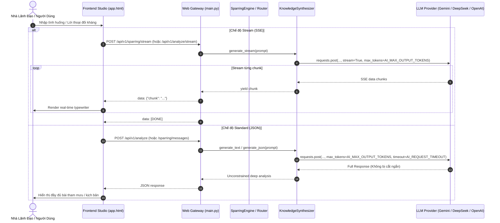

# PLAN-UNCONSTRAINED-AI-SYNTHESIS: Khai Phóng Độ Sâu & Mở Khóa Giới Hạn Sinh Chữ Của AI — Technical Plan

**ID:** PLAN-UNCONSTRAINED-AI-SYNTHESIS  
**Spec Tham Chiếu:** SPEC-UNCONSTRAINED-AI-SYNTHESIS  
**Người lập:** Main Agent  
**Trạng thái:** ready_for_review  

---

## 1. Bản vẽ Thiết kế Kiến trúc (Architectural Blueprint)



---

## 2. Danh Sách Tệp Tin Ảnh Hưởng (Impacted Files & Scoping)

| Tệp tin | Loại hành động | Trách nhiệm thực hiện |
| :--- | :--- | :--- |
| `src/nhan_thuat/runtime/synthesizer.py` | Sửa | 1. Bổ sung cấu hình `AI_MAX_OUTPUT_TOKENS` và `AI_REQUEST_TIMEOUT`.<br/>2. Truyền `max_tokens` (hoặc `max_completion_tokens`) vào payload API.<br/>3. Thêm phương thức `generate_stream(prompt)` hỗ trợ SSE.<br/>4. Điều chỉnh `_build_prompt` loại bỏ chỉ dẫn co ngắn. |
| `src/nhan_thuat/engine/sparring_engine.py` | Sửa | Loại bỏ "tối đa 4 câu", "1 câu" trong `_generate_sparring_response`, mở rộng kịch bản đối kháng sâu sắc. |
| `src/nhan_thuat/runtime/war_room.py` | Sửa | Bổ sung `max_tokens` và tăng timeout cho `_call_llm_json`. |
| `backend/app/engine/nhan_thuat_api.py` | Sửa | Điều chỉnh prompt sparring và chẩn đoán nhân sự, bỏ các yêu cầu thu gọn độ dài. |
| `backend/app/main.py` | Sửa | Thêm endpoint streaming `/api/v1/analyze/stream` và `/api/v1/sparring/stream`. |
| `frontend/app.html` & `frontend/scroll_demo.html` | Sửa | Tối ưu hiển thị văn bản dài, bổ sung hỗ trợ stream reader cho giao diện chat/sparring. |
| `tests/test_unconstrained_synthesis.py` | Thêm mới | Test cases kiểm tra cấu hình token, stream generator, prompt uncapping và SSE endpoints. |

---

## 3. Thiết Kế Dữ Liệu & Giao Diện Hợp Đồng (Data & Interface Contracts)

### 3.1. Cấu hình Runtime Environment
- `AI_MAX_OUTPUT_TOKENS`: Mặc định `8192` (cho phép nâng lên 16,384 hoặc giá trị theo model).
- `AI_REQUEST_TIMEOUT`: Mặc định `120` giây (thay vì 60s).

### 3.2. SSE Stream Endpoint Contract
- **Method & Path:** `POST /api/v1/sparring/stream`
  - **Headers:** `Content-Type: application/json`
  - **Payload:** `{"session_id": "...", "message": "...", "philosophy_lens": "LEGALISM"}`
  - **Response Format:** `text/event-stream; charset=utf-8`
    ```
    data: {"type": "meta", "philosophy_lens": "LEGALISM"}

    data: {"type": "content", "chunk": "Lập luận của bạn "}

    data: {"type": "content", "chunk": "đang bộc lộ sự ngây thơ..."}

    data: [DONE]
    ```

---

## 4. Chiến Lược Thử Nghiệm & Kiểm Chứng (Testing & Verification Strategy)

- **Unit Tests (`tests/test_unconstrained_synthesis.py`):**
  - Kiểm tra `KnowledgeSynthesizer._call_provider` có truyền `max_tokens` trong payload.
  - Kiểm tra `generate_stream` trả về generator tuần tự.
  - Kiểm tra prompt trong `SparringEngine` không còn chứa chuỗi "Tối đa 4 câu".
- **Regression Tests:**
  - `pytest tests/test_synthesizer.py --basetemp=tmp_pytest`
  - `pytest tests/test_sparring_security.py --basetemp=tmp_pytest`
  - `pytest tests/test_unconstrained_synthesis.py --basetemp=tmp_pytest`
- **Integrity Validation:**
  - `python scripts/validate_all.py`
  - `python -m ruff check src backend tests`

---

## 5. Rủi Ro Kỹ Thuật & Phương Án Dự Phòng (Technical Risks & Fallbacks)

- **Rủi ro:** Khi gọi model cũ không hỗ trợ `max_completion_tokens` hoặc bị lỗi tham số.
  - **Dự phòng:** Dùng `max_tokens` tương thích chuẩn OpenAI, tự động bắt lỗi HTTP 400 nếu provider không nhận và retry không kèm tham số.
- **Rủi ro:** Mạng chập chờn khi streaming.
  - **Dự phòng:** Client tự động fallback hiển thị toàn bộ nội dung nếu stream bị đứt quãng.

